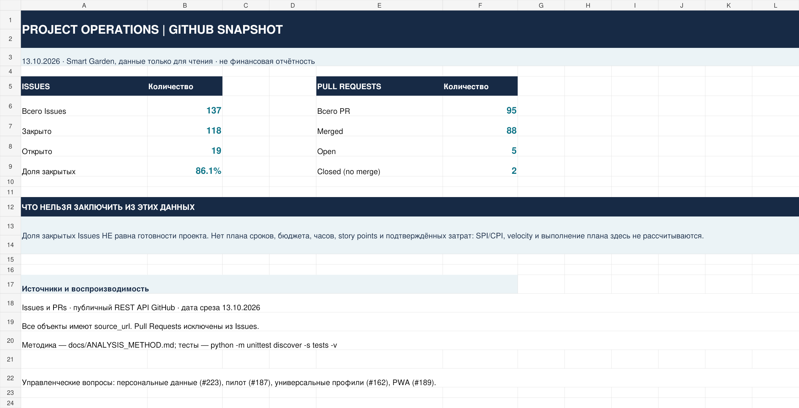

# Project Analyst Portfolio

**Аналитика IT-проекта: GitHub → Excel → SQL → управленческий отчёт**

Практический кейс для позиций Junior Project Analyst и PMO Analyst. В качестве источника использована история [ПРОМАКС / Smart Garden](https://github.com/ONN9IX/smart-garden) — моего собственного IT-проекта. Данные получены через публичный GitHub API; исходный репозиторий не изменялся.

## Задача

По спискам задач и изменений трудно быстро оценить текущую нагрузку команды и выделить нерешённые вопросы. Для учебно-практического кейса я разделил GitHub Issues и Pull Requests, подготовил выгрузки и собрал отчётность для обсуждения статуса проекта.

**Дата среза:** 13 октября 2026 года. Ниже исторические показатели; текущие статусы проекта могут отличаться.

| Показатель | Результат |
|---|---:|
| Issues | 137 |
| Закрытые Issues | 118 |
| Открытые Issues | 19 |
| Доля закрытых Issues | 86,1% |
| Pull Requests | 95 |
| PR, объединённые в основную ветку | 88 |
| Открытые PR | 5 |

**Важно:** 86,1% — доля закрытых записей, а не процент готовности продукта. Одна Issue может описывать небольшую задачу, другая — целый этап разработки.

## Excel-дашборд

[Открыть Excel Project Dashboard](Project%20Dashboard.xlsx) — показатели по задачам, PR, динамика активности, источники и реестр рисков.



## Выводы для обсуждения с руководителем проекта

1. **Разделять задачи и изменения кода.** GitHub API `/issues` возвращает также PR; без фильтрации их можно посчитать дважды.
2. **Уточнить правила закрытия задач.** По статусу `closed` нельзя автоматически заключить, что функциональность поставлена и принята.
3. **Согласовать плановую базу.** В доступном наборе нет достоверных плановых сроков, затрат и трудоёмкости, поэтому рассчитать отклонения по срокам или бюджету нельзя.
4. **Проверить готовность к пилоту.** Исторические открытые вопросы о персональных данных и пилотном использовании требуют отдельного решения владельца проекта.

[Статусный отчёт](reports/PROJECT_STATUS_REPORT.md) · [Методика расчётов](docs/ANALYSIS_METHOD.md) · [Реестр рисков](docs/RISK_REGISTER.md)

## Что находится в репозитории

| Материал | Что демонстрирует |
|---|---|
| [Excel Project Dashboard](Project%20Dashboard.xlsx) | Отчётность, формулы, сводные показатели и визуализация |
| [SQL-запросы](sql/02_business_queries.sql) | CTE, JOIN, группировки, оконные функции |
| [Project Charter](docs/PROJECT_CHARTER.md) | Цель, границы и критерии приёмки аналитического кейса |
| [WBS](docs/WBS.md) и [Roadmap](docs/ROADMAP.md) | Структура работ, контрольные точки и зависимости |
| [RACI](docs/RACI.md) | Учебный вариант распределения ответственности |
| [Risk Register](docs/RISK_REGISTER.md) | Оценка рисков с привязкой к GitHub Issues |
| [Status Report](reports/PROJECT_STATUS_REPORT.md) | Управленческие выводы и следующие действия |
| [Исходные CSV](data/) и [Python-скрипты](scripts/) | Проверяемые источники и воспроизводимость |

Отдельно есть [EVM Training.xlsx](EVM%20Training.xlsx) для практики PV, EV, AC, SPI и CPI. **Все бюджеты и недели в этой книге смоделированы специально для обучения** — это не затраты Smart Garden.

## Резюме

[Junior Project Analyst — PDF](resume/Junior_Project_Analyst.pdf) · [Junior PMO Analyst — PDF](resume/Junior_PMO_Analyst.pdf)

[Редактируемые DOCX и пояснения](resume/README.md)

## Запуск проверок

```bash
python scripts/build_reports.py
python -m unittest discover -s tests -v
```

Для загрузки нового среза: `python scripts/refresh_from_github.py`. Скрипт выполняет только чтение из Smart Garden. Excel и исторические документы автоматически не обновляются после запуска, их пересборка описана в [инструкции](docs/EXCEL_RECREATE.md).

**Границы анализа:** по этим GitHub-данным нельзя восстановить рабочие часы, реальные расходы, выполнение календарного плана или оценить личную производительность участников команды. Риски и RACI — предложения для учебного разбора, не утверждённые решения проекта.
