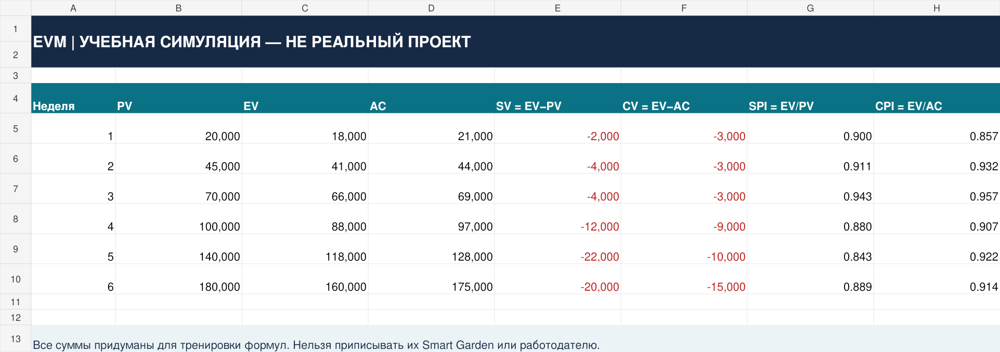
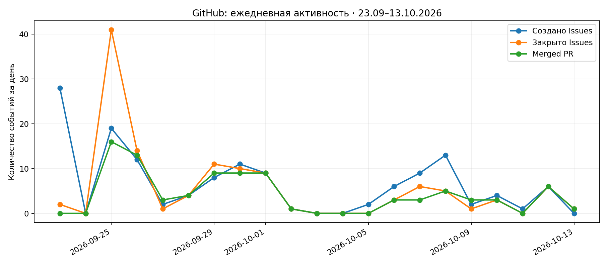
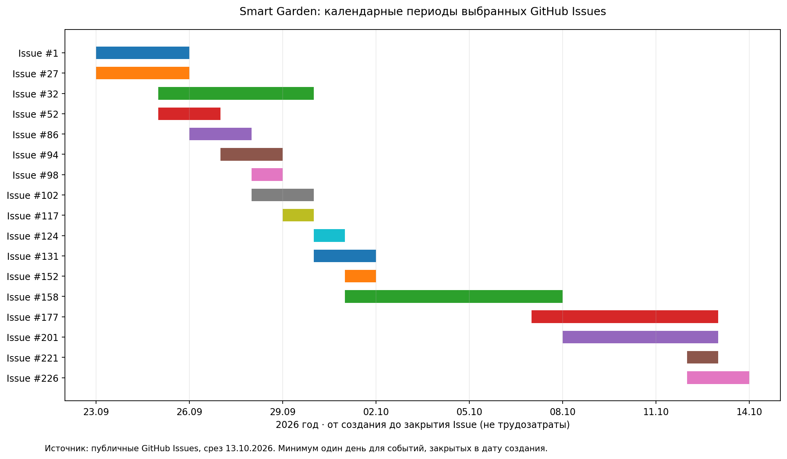

# Project Analyst Portfolio · Project Operations Case

**Практический кейс для Junior Project Analyst / PMO Analyst.** Реальная история задач и изменений IT-проекта [ПРОМАКС / Smart Garden](https://github.com/ONN9IX/smart-garden) использована как **read-only источник**; аналитические документы, отчёты, SQL и Excel вынесены в **отдельный репозиторий**. Исходный Smart Garden этим кейсом не изменяется.

> **Снимок GitHub на 13.10.2026.** Это исторический срез, а не мониторинг в реальном времени. Аналитика проекта — учебно-практическая работа, не корпоративный опыт и не утверждённый командой PMO-процесс.

## Что удалось проверить

| Показатель | Значение |
|---|---:|
| Обычных GitHub Issues (PR исключены) | **137** |
| Закрытых Issues | **118** |
| Открытых Issues | **19** |
| Доля закрытых Issues | **86,1%** |
| Всего Pull Requests | **95** |
| Объединённых Pull Requests | **88** |
| Открытых Pull Requests | **5** |
| Закрытых без merge PR | **2** |

**86,1% не означает, что продукт готов на 86,1%:** задачи неоднородны, нет согласованной системы весов и единой плановой базы. Нельзя выводить SPI, CPI, реальную скорость команды или финансовые результаты из одного списка GitHub Issues.

## Резюме

- [Junior Project Analyst — PDF](resume/Junior_Project_Analyst.pdf) · [Word](resume/Junior_Project_Analyst.docx)
- [Junior PMO Analyst — PDF](resume/Junior_PMO_Analyst.pdf) · [Word](resume/Junior_PMO_Analyst.docx)
- Контакт: [профиль ONN9IX](https://github.com/ONN9IX).

## Артефакты кейса

- [`Project Dashboard.xlsx`](Project%20Dashboard.xlsx) — Excel: KPI с формулами, исходные таблицы Issues/PR, динамика с графиком и риск-реестр.
- [`EVM Training.xlsx`](EVM%20Training.xlsx) — **отдельная синтетическая** учебная модель PV/EV/AC, SPI/CPI, не бюджет Smart Garden. См. [`docs/EVM_SIMULATION.md`](docs/EVM_SIMULATION.md).
- [`reports/PROJECT_STATUS_REPORT.md`](reports/PROJECT_STATUS_REPORT.md) — фактический статус, проблемы и действия.
- [`reports/daily_activity.csv`](reports/daily_activity.csv) — календарная динамика Issues/PR.
- [`docs/PROJECT_CHARTER.md`](docs/PROJECT_CHARTER.md) — рамки проекта и ограничения.
- [`docs/WBS.md`](docs/WBS.md) — структура работ: завершённые этапы и отдельно будущие направления.
- [`docs/ROADMAP.md`](docs/ROADMAP.md) — фактические контрольные точки, зависимости и границы применимости диаграммы Ганта.
- [`docs/RACI.md`](docs/RACI.md) — **предложение** распределения ответственности, не реальные утверждённые роли.
- [`docs/RISK_REGISTER.md`](docs/RISK_REGISTER.md) — экспертные гипотезы рисков с ссылками на открытые Issues.
- [`docs/ANALYSIS_METHOD.md`](docs/ANALYSIS_METHOD.md) — источники, формулы и ограничения метрик.
- [`sql/`](sql/) — PostgreSQL schema, загрузка CSV и бизнес-запросы.
- [`scripts/`](scripts/) и [`tests/`](tests/) — воспроизводимый расчёт и автоматические проверки.
- [`resume/`](resume/) — резюме Junior Project Analyst и PMO Analyst (публичные версии с контактом через GitHub).

## Предпросмотр Excel

GitHub предлагает скачать Excel и Word; для просмотра резюме в браузере используй PDF выше. Ниже доступны изображения основных листов Excel.




[Результаты проверки материалов](docs/VERIFICATION.md).

## Визуализация активности





## Что показал анализ

1. **Операционный реестр активен:** в снимке есть как закрытые поставки, так и незавершённые направления. GitHub workflow не равен готовому управленческому baseline.
2. **Два разных типа сигналов:** Issue — описание работы, PR — изменение в коде. Их нужно считать отдельно, иначе можно удвоить объём работы.
3. **Главные управленческие вопросы:** план-график, проектный бюджет, реальная нагрузка команды и причины задержек **не восстанавливаются надёжно** из текущего набора полей API. Для честного план-факт отчёта нужны baseline, фактические трудозатраты и сроки.
4. **Пилотная готовность ограничена:** технический MVP не означает право использовать реальные персональные данные детей и родителей. См. [#187](https://github.com/ONN9IX/smart-garden/issues/187) и [#223](https://github.com/ONN9IX/smart-garden/issues/223).

## Как воспроизвести

```bash
python scripts/build_reports.py
python -m unittest discover -s tests -v
```

Для **обновления** публичного снимка через GitHub REST API (требуется интернет):

```bash
python scripts/refresh_from_github.py
python scripts/build_reports.py
```

Этот скрипт только читает внешний репозиторий, ничего в нём не создаёт, не редактирует и не удаляет. Excel в репозитории зафиксирован на дату снимка и не обновляется автоматически после refresh — повторная сборка описана в `docs/EXCEL_RECREATE.md`.

## Моя роль и границы

Этот кейс демонстрирует аналитическую обработку публичного реестра задач: подготовку выгрузки, контроль качества, расчёт KPI, проектную отчётность, SQL и Excel. Из данных **нельзя** делать вывод о фактической должности сотрудника, оплате, оценке индивидуальной эффективности или длительности коммерческой работы.
