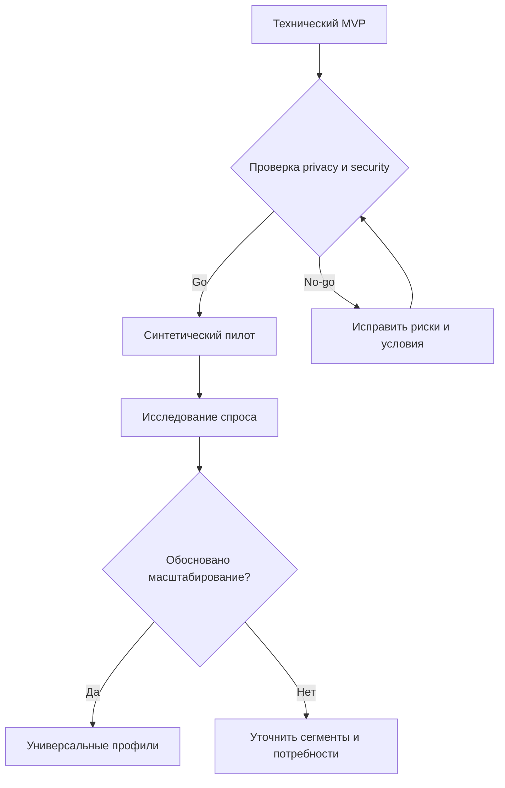

# Roadmap — факты и зависимости

## Исторические контрольные точки

| Дата закрытия Issue | Контрольная точка | Источник |
|---|---|---|
| 2026-09-25 | Stage 1 manual | [#33](https://github.com/ONN9IX/smart-garden/issues/33) |
| 2026-09-26 | Stage 2 coordination | [#52](https://github.com/ONN9IX/smart-garden/issues/52) |
| 2026-09-27 | Stage 3 acceptance | [#86](https://github.com/ONN9IX/smart-garden/issues/86) |
| 2026-09-28 | Stage 4 acceptance | [#98](https://github.com/ONN9IX/smart-garden/issues/98) |
| 2026-09-29 | Stage 5 acceptance | [#117](https://github.com/ONN9IX/smart-garden/issues/117) |
| 2026-10-01 | Stage 6 acceptance | [#152](https://github.com/ONN9IX/smart-garden/issues/152) |

Даты не выданы за оценку времени разработки: это дни закрытия контрольных GitHub Issues.

## Предложенная логика зависимостей (аналитическая гипотеза)

Это **не согласованный план владельца**. Последовательность сформулирована для демонстрации анализа зависимостей; она не включает сроки, бюджеты или обещания релиза.

## Диаграмма Ганта

[`ISSUE_TIMELINE.png`](../reports/ISSUE_TIMELINE.png) показывает **периоды существования отдельных Issues** по календарным датам их создания и закрытия. Это не диаграмма фактической загрузки персонала: GitHub не содержит почасовые трудозатраты или полный календарный график проекта.
